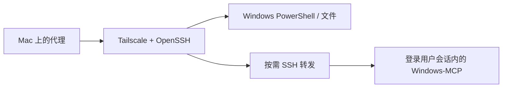

# Windows Remote On Demand

让 Mac 上的 AI 代理通过 **Tailscale + Windows 原生 OpenSSH** 执行命令、传文件；需要操作窗口时才启动 **Windows-MCP**，用完关闭。

Run Windows commands and transfer files from macOS; enable desktop tools only when needed. The controller uses Python's standard library and OpenSSH. [English overview](docs/README.en.md).

这是一套已在真实 Mac / Windows 11 环境跑通的方法与轻量脚本。公开版仅去除私人配置、改用通用路径和配置模板，保留原有执行方式。适合个人双机工作流；没有托管控制台或常驻代理平台。



## 它解决什么

| 需求 | 入口 |
| --- | --- |
| 执行 PowerShell、调用已有 Python / CUDA 环境 | `tools/windows_remote.py run` |
| 上传输入、下载结果，支持中文与空格路径 | `put` / `get` |
| 查看窗口、截图、点击和输入 | `tools/windows_desktop.py` 按需调用 Windows-MCP |
| 自己手动传文件或操作桌面 | Taildrop；已有远程桌面软件仍可保留 |

命令和文件任务不启动桌面服务；Tailscale 和 SSH 保持可连接。Windows-MCP 没有登录自启触发器，也不注册到 AI 客户端的常驻 MCP 工具列表。任务结束关闭服务和转发，意外中断有 300 秒空闲退出。

这能避免每次聊天都携带完整桌面工具定义，但 Skill 简短描述、实际使用的工具说明、画面和结果仍会使用上下文。没有“零 token”或节省比例的承诺。

## 开始使用

1. 按 [安装与连接](docs/setup.md) 配置 Tailscale、公钥登录和严格主机指纹校验。
2. 仅需命令 / 文件：使用 `windows_remote.py`。
3. 需要桌面：在 Windows 的独立环境安装 Windows-MCP，再从 Mac 运行一次 `setup`。
4. 可选安装 [便携 Skill](skills/windows-remote-on-demand/SKILL.md)，让代理按需选用入口。

Mac：Python 3.9+ 与系统自带 OpenSSH。Windows：本流程在 Windows 11、原生 OpenSSH、PowerShell 5.1 和 Windows-MCP 0.8.8 上验证；Windows-MCP 的独立环境使用 Python 3.14。Mac 侧不需要安装 Paramiko 或 MCP SDK。

先下载或克隆本仓库，在仓库根目录运行：

```bash
python3 tools/windows_remote.py info
python3 tools/windows_remote.py run --command 'Get-ChildItem -LiteralPath D:\RemoteWork'
python3 tools/windows_remote.py run --command 'New-Item -ItemType Directory -Force -Path D:\RemoteWork\demo | Out-Null'
python3 tools/windows_remote.py put examples/hello.txt D:/RemoteWork/demo/hello.txt
python3 tools/windows_remote.py get D:/RemoteWork/demo/hello.txt outputs/hello.txt
```

桌面操作：

```bash
python3 tools/windows_desktop.py start
python3 tools/windows_desktop.py tools
python3 tools/windows_desktop.py describe Snapshot
python3 tools/windows_desktop.py call Snapshot --args '{"use_vision":false}'
python3 tools/windows_desktop.py stop
python3 tools/windows_desktop.py status
```

`tools` 只输出工具名称；`describe` 才读取一个工具的说明和参数。图像保存到本地 `outputs/windows-desktop`，返回文件路径，不把 base64 图像塞进文本输出。

## 配置与边界

- SSH 示例：[examples/ssh-config.example](examples/ssh-config.example)。替换地址、账号和本机密钥路径，不使用示例占位符连接。
- 通用默认工作目录为 `D:\RemoteWork`。桌面服务入口默认 `D:\RemoteWork\Tools\Windows-MCP`；路径集中在 `windows_desktop.py` 顶部，已有环境的复用位置见安装说明。
- 两端工作目录各自独立，按任务传输输入和结果，不做全盘自动同步。
- `run` 同步等待默认 60 秒；`--timeout 120` 放在子命令前。返回 124 表示本机等待超时，远端结果未知，不要盲目重发写入、安装或其他有副作用的任务。
- 桌面操作要求 Windows 用户已登录、桌面可访问；普通 SSH 服务会话不能直接替代交互桌面。锁屏、UAC 安全桌面和重启未登录不在当前保证范围内。
- 本版本用于单控制端个人工作流，避免多方共用同一桌面会话。`setup` 前先停止服务；不需要每次使用都重复安装或体检。

## 已验证的内容

基线流程已实测：公钥与主机指纹校验、中文输出、原生命令退出码、PowerShell 异常、长中文脚本、中文空格路径、二进制往返及 SHA-256；Windows-MCP 交互会话启动、12 个工具发现、控制状态和显示器读取、未认证请求拒绝、主动停止和空闲退出。

安装验收没有点击或输入。异网、锁屏/UAC、重启未登录、长计算任务断线保活和实际 GPU 计算需要在对应场景确认。显卡信息能读回不等于某个 CUDA 项目已通过。公开版的路径替换、配置模板不是对所有机器的兼容承诺。

## 隐私、卸载与来源

账号、设备名、实际 IP、私钥、公钥、主机指纹、认证 token、个人路径、截图和私人工作区历史均未随仓库发布。运行后产生的配置、长脚本、日志和截图属于使用者的私有数据，参见 [隐私与清理](docs/privacy.md)。

代码使用 MIT 许可证。Windows-MCP 是独立的上游项目，本仓库不包含其源码或依赖包，也不把其许可证覆盖为本项目许可证。

- [CursorTouch/Windows-MCP](https://github.com/CursorTouch/Windows-MCP)：桌面工具。
- [Microsoft：Windows OpenSSH 配置](https://learn.microsoft.com/en-us/windows-server/administration/OpenSSH/openssh-server-configuration)：原生 SSH 与管理员公钥位置。
- [Tailscale：无人值守模式](https://tailscale.com/docs/how-to/run-unattended)：网络客户端在注销后的行为；不等同于桌面控制可在注销后运行。
- [Tailscale：Taildrop](https://tailscale.com/docs/features/taildrop)：手动文件传输。

通用 SSH 项目 `badseal/ssh-skill`、`classfang/ssh-mcp-server` 可作为其他场景参考，但其 POSIX 辅助操作不是本方法的 Windows 执行入口。
